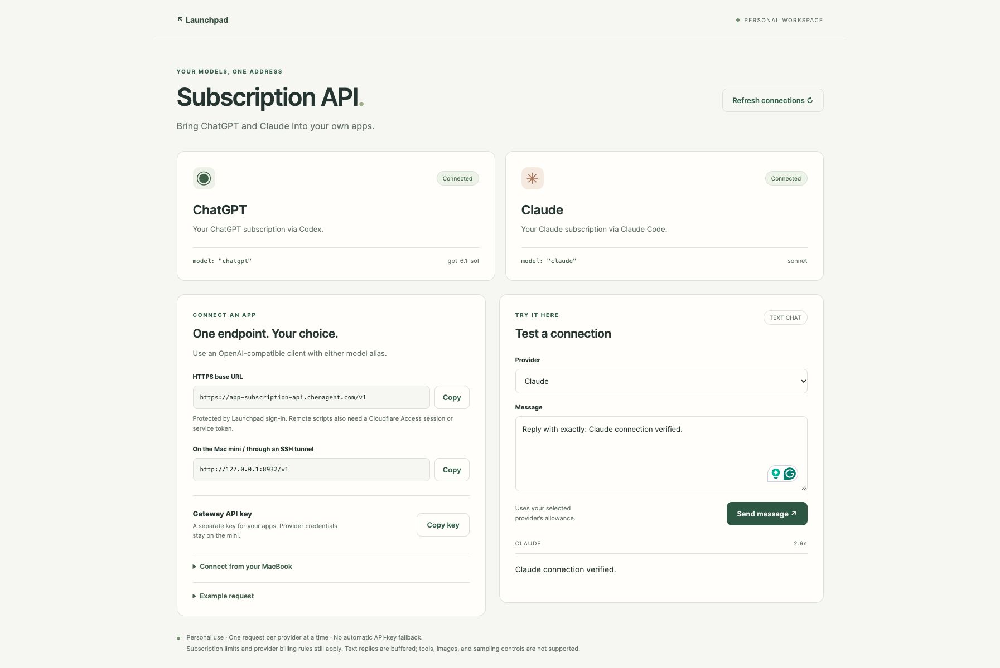

# Subscription API

A private, single-user HTTP gateway for ChatGPT and Claude subscriptions, with a small dashboard for connection status, endpoint settings, and test prompts. Select a specific model or a saved `chatgpt` / `claude` default through one OpenAI-compatible **text Chat Completions** endpoint.

The gateway invokes the official Codex and Claude Code CLIs using their existing subscription sign-ins. It does not scrape websites, extract browser cookies, or silently fall back to provider API keys. It is not affiliated with OpenAI or Anthropic.



## Status and limitations

The personal API and legacy CI text reviewer have been deployed and smoke-tested. An optional repository-review portal, project job API and Docker sandbox are implemented on this branch; sandbox live acceptance and client rollout are pending. The sandbox pins Claude Code 2.1.301. See [validation evidence](docs/validation.md) and the [artifact index](docs/artifacts.md).

- Personal, single-user use. This is not a shared subscription service or a replacement for the full OpenAI/Anthropic APIs.
- The personal API supports `GET /v1/models` and `POST /v1/chat/completions`, accepting only `model`, `messages`, and optional `stream`.
- The personal API is text only. Tool calls, images, files, Responses API, sampling controls, output-token limits, and structured-output guarantees are unsupported. Unsupported parameters return an error rather than being ignored.
- Messages are serialized as a role-labeled conversation in a CLI prompt. This approximates chat history; it does not preserve the providers' native API role hierarchy exactly. CLI instructions may also affect replies.
- SSE is supported for client compatibility, but replies are buffered and delivered when the CLI completes. Heartbeats keep the connection active. Errors after streaming starts arrive as an `error` object, followed by `[DONE]`.
- At most one in-flight request per provider, 90-second inference timeout, 100 messages, 100,000 characters, and a 256 KB HTTP body limit. Requests above these limits fail explicitly.
- Subscription limits, model access, credit settings, and provider terms still apply. Signing in does not guarantee every model is available or that all third-party usage is covered by included allowance. No pricing or quota estimates are invented.
- The gateway does not save prompts or responses itself. CLI/provider diagnostics, account history, and provider retention policies remain outside its control. Gateway request directories are removed after completion.

## Repository reviews (staged)

The owner portal at `/reviews` configures project keys, allowed agents and immutable skill revisions. `/ci/review` submits asynchronous jobs against exact head/base commits. The candidate runner reads repository files in an isolated container and returns structured output, execution metadata and optional injection warnings. Clients must still validate completeness and exact-source findings.

This route stays disabled without `REVIEW_IMAGE_DIGEST`. Live skill invocation, permission denial and schema completion are pending after a subscription-limit failure; do not activate it based on the offline smoke alone. See the [review API and acceptance status](docs/review-agents.md), [deployment runbook](docs/deployment.md#repository-review-rollout) and [sanitized evidence](docs/validation.md#review-agent-candidate--october-19-2026).

The legacy `/ci/slice/review` remains available for both Slice and CuseSublets, including Cuse's `full-context-v1` mode (2M message characters, 3 MB body, 15-minute inference). Its limits are independent of the personal API and the new 400K-character/640 KB repository-review route. Keep it until **both clients** complete migration.

## Prerequisites

- Node.js 22 or newer, npm, and the official `codex` and `claude` executables available on `PATH` (or configured absolute paths).
- Eligible ChatGPT and Claude accounts, signed in on the host running the service.
- An authenticated reverse proxy for remote browser access, or an SSH tunnel for private programmatic use. The server binds exclusively to `127.0.0.1`.

## Quickstart

```sh
git clone https://github.com/ichen27/subscription-api.git
cd subscription-api
npm ci
npm test
npm run check

codex login
claude auth login --claudeai
codex login status
claude auth status

npm start
```

The default URL is `http://127.0.0.1:8932`. The first start creates `.runtime/gateway.key` with owner-only permissions. Read that file locally to enter the dashboard or configure your own client. Do not paste the key into an issue, commit, screenshot, or chat.

Configuration can be set through environment variables, or copied from `.env.example` and loaded with `node --env-file=.env src/main.mjs`. `npm start` itself does not load `.env`. In production, point `APP_DATA_DIR` at a persistent private directory outside the checkout. By default, provider credentials remain in their vendor-managed stores. Background services that cannot use Claude's interactive login can explicitly configure a private automation OAuth token file; see [deployment](docs/deployment.md).

## Usage

```sh
export GATEWAY_KEY="$(cat .runtime/gateway.key)"
curl --fail-with-body http://127.0.0.1:8932/v1/models \
  -H "Authorization: Bearer $GATEWAY_KEY"

curl --fail-with-body http://127.0.0.1:8932/v1/chat/completions \
  -H "Authorization: Bearer $GATEWAY_KEY" \
  -H 'Content-Type: application/json' \
  -d '{"model":"chatgpt","messages":[{"role":"user","content":"Say hello in one sentence."}]}'
```

Change `model` to `claude` to use Claude’s saved default, or select a specific model with `chatgpt/gpt-6.1-sol`, `chatgpt/gpt-6-luna`, `claude/opus`, or `claude/claude-opus-4-8`. Add `"stream":true` for buffered SSE. Keep API keys in environment variables or a credential store. See [sample input and output](examples/) for the exact response shape.

In a compatible client, set:

| Setting | Value |
| --- | --- |
| Base URL | `http://127.0.0.1:8932/v1` |
| API key | Contents of `gateway.key` |
| Model | `chatgpt`, `claude`, or `provider/model-id` |

Clients that always send extra fields, require tool calling, or require the Responses API will need adaptation. This project deliberately does not claim complete OpenAI compatibility.

For another computer, forward a local port to the service host:

```sh
ssh -N -L 8932:127.0.0.1:8932 YOUR_SERVER
```

Then use the same local base URL and key on that computer. The public HTTPS URL requires **both** an authenticated owner session and the gateway bearer key. An API key or Cloudflare service token alone does not pass the launcher’s owner-identity check. See [deployment](docs/deployment.md).

## Choosing models

In the dashboard, choose **Provider**, then **Model**. Choose **Custom model ID…** to enter a name absent from the suggestions. **Save as default** changes the selected provider’s short alias across all clients and persists through restarts; merely sending a request does not change the default.

`GET /v1/models` lists the two aliases, suggested model IDs, and each saved default. It is a curated convenience list, not a live entitlement check. Any syntactically valid qualified model ID can be requested. Names allow letters, digits, dots, underscores, hyphens, and an optional `[1m]` suffix. The gateway forwards the chosen name to the corresponding official CLI. Account restrictions, CLI versions, and provider alias/fallback policies still apply; the response’s `model` field echoes the requested route, not an independently verified upstream version. A saved default is not validated by making a billable request; use **Send message** to test access.

General API requests use the selected Codex model’s default reasoning effort. The dedicated Slice CI route described below fixes High reasoning. Claude aliases can change version over time; use a full ID when you need to request a particular version. See [OpenAI models](https://learn.chatgpt.com/docs/models) and [Claude model configuration](https://code.claude.com/docs/en/model-config). Some selections, including Claude Fable, may consume usage credits under your plan. The gateway does not enable paid API-key fallback or bypass provider billing settings.

## GitHub Actions

Repository test CI uses disposable Linux ARM64 workers, while GitHub Actions
retains PR scheduling and check results. See [worker setup, validation, usage
reporting, and rollback](docs/isolated-ci.md). These test workers have no provider
credentials and are separate from the running gateway service.

A separate, disabled-by-default `POST /ci/slice/review` endpoint supports Slice's protected reviewer. Its default mode accepts only `claude/claude-opus-5-5`, non-streaming text requests and a dedicated review key; the key cannot access the personal API or dashboard settings. The server requests High reasoning, disables automatic model switching on flagged requests, and retains tool isolation. Claude Code 2.1.280 or newer is required for Opus 5.5; this integration was verified with 2.1.301. See [the scoped connection guide](docs/slice-ci.md). This code alone does not configure Cloudflare or activate GitHub calls.

CuseSublets opts into a full-context mode on the same authenticated endpoint using `X-Review-Mode: full-context-v1`, model `claude/claude-opus-5-5[1m]`, and an additional `json_schema` object. This mode accepts up to 2,000,000 message characters / 3,000,000 request bytes and allows 15 minutes of inference. It requires bounded, reference-free object JSON Schema (16 KB maximum), passes it to Claude Code's `--json-schema`, and returns only the validated `structured_output`. Missing structured output fails even when plain text looks valid. Existing Slice requests retain their original 400,000-character / 640 KB / five-minute limits. The personal API still rejects schema parameters. Use asynchronous jobs and keep polling at intervals below two minutes. Explicit extended context must be supported by the signed-in account; failure does not switch models or authentication methods.

CI can call this endpoint to analyze text, diffs, or test logs. Builds and tests still run in the CI runner. See the [CI integration guide](docs/github-actions.md) and [example request step](examples/github-actions-step.yml). The example requires a working authenticated network route; live connection status is recorded in [the Slice CI guide](docs/slice-ci.md).

## Architecture and configuration

```text
Dashboard / API client
  → loopback HTTP server (auth, validation, cancellation, JSON/SSE)
  → provider adapter (subscription check, one request per provider)
  → Codex or Claude Code (isolated request directory, tools disabled)
```

`src/server.mjs` owns HTTP and the trusted launcher contract. `src/models.mjs` owns model routing and persistent defaults. `src/providers.mjs` owns CLI arguments, input validation, and response parsing. `src/process.mjs` owns bounded subprocesses and an allowlisted environment. `public/` contains the dashboard; no framework or runtime npm dependencies are required.

| Environment variable | Default / purpose |
| --- | --- |
| `HOST` | Only `127.0.0.1` is accepted |
| `PORT` | `8932` |
| `APP_DATA_DIR` | `.runtime` in the working directory |
| `PUBLIC_ORIGIN` | `http://127.0.0.1:8932`; exact public origin, no trailing slash |
| `LAUNCHER_OWNER_EMAIL` | Empty; enables the trusted launcher identity contract only when explicitly configured |
| `CODEX_BIN`, `CLAUDE_BIN` | `codex`, `claude`; production should use absolute executable paths |
| `CI_REVIEW_KEY_FILE` | Optional private file for the dedicated Slice CI endpoint; unset disables it |
| `CLAUDE_OAUTH_TOKEN_FILE` | Optional owner-only file containing a subscription OAuth token from `claude setup-token`; injected only into Claude processes |
| `CHATGPT_MODEL`, `CLAUDE_MODEL` | `gpt-6.1-sol`, `sonnet`; initial alias defaults, overridden by saved dashboard settings |

Inherited environment variables containing API keys, alternative provider URLs, OAuth overrides, and Node preload options are excluded from provider processes. The only optional credential injection is the explicitly configured Claude subscription OAuth file, which must be an owner-only regular file owned by the service user. Codex is forced to ChatGPT authentication and ignores user configuration. Claude runs in safe/restricted mode with an empty tool allowlist. CLI upgrades may change flags, authentication, or output formats; rerun a live smoke test after upgrading.

## Validation and contributions

Run `npm ci`, `npm test`, and `npm run check` before proposing changes. CI runs without provider credentials and uses deterministic provider substitutes; live subscription tests are performed separately. Add regression tests for changed auth, billing-path selection, request validation, and subprocess lifecycle behavior.

Use focused branches and pull requests. Report bugs with the CLI versions, HTTP error code, and a harmless reproduction. Exclude tokens, private prompts, account identifiers, and unredacted CLI output. This repository is private and requires authorized GitHub access; [LICENSE](LICENSE) reserves redistribution rights. Provider software and documentation retain their own licenses and terms.
